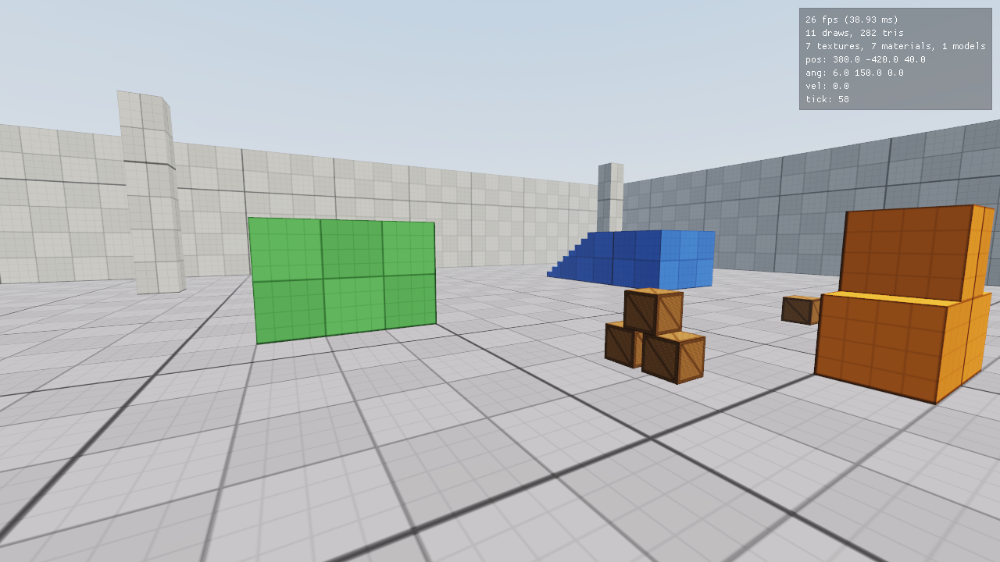

# k

A 3D game engine in the spirit of Valve's **Source 1**: compiled BSP maps with precomputed
visibility and baked lighting, an authoritative client/server split (even in single-player),
entity input/output wiring, and a console + cvar system driving everything.

> Status: **all 8 roadmap phases done** (foundation, rendering, map pipeline, movement,
> entities, physics, audio, networking, polish). Build maps in TrenchBroom, compile them with
> `kbsp` (BSP, vis, baked lighting), wire up doors, buttons, elevators and triggers with
> Source-style entity I/O, push and throw physics props, and play together over the network
> with client-side prediction, interpolation and lag compensation. Health, a HUD, a main menu,
> particles, decals and packed content are in too. See [docs/ROADMAP.md](docs/ROADMAP.md) for
> what's next.
> See [docs/ROADMAP.md](docs/ROADMAP.md).



Documentation for every component is in [docs/](docs/README.md).

## Building

Needs CMake 3.24+, a C++20 compiler (GCC 13+, Clang 16+, MSVC 2022) and OpenGL 4.5.
Dependencies (SDL3, glm, Dear ImGui, stb_image, cgltf, Jolt Physics, miniaudio, doctest) are
downloaded automatically.

```sh
cmake -S . -B build -G Ninja -DCMAKE_BUILD_TYPE=RelWithDebInfo
cmake --build build
./build/bin/k
```

On Linux you need the X11/GL development headers first:

```sh
sudo apt install libx11-dev libxext-dev libxrandr-dev libxcursor-dev libxi-dev \
  libxfixes-dev libxss-dev libgl-dev libegl-dev libasound2-dev libpulse-dev
```

macOS is not supported yet (Apple stops at OpenGL 4.1; a Metal/Vulkan backend is on the roadmap).

## Running

| Action | Default key |
|---|---|
| Move | W A S D |
| Use (buttons, doors, pick up props) | E |
| Fire (hitscan) / throw a held prop | Mouse 1 |
| Jump / crouch | Space / Ctrl (fly up/down in noclip) |
| Walk slowly | Alt |
| Turn / look (keyboard) | Arrow keys |
| Menu | Esc |
| Console | `` ` `` |
| Screenshot | F5 |
| FPS / position overlay | F9 / F10 |

Command-line options work like Source:

```sh
./build/bin/k -w 1920 -h 1080 -fullscreen +sv_cheats 1 +map devroom
./build/bin/k -dedicated +map devroom          # headless server, reads commands from stdin
./build/bin/k -nosound                         # don't open an audio device
```

## Multiplayer

Every game you start with `map` is also a listen server on UDP port 27015 (`sv_listen 0` to
turn that off). Others join with `connect`:

```sh
./build/bin/k +map devroom                         # host
./build/bin/k +connect 192.168.1.20                # join (port defaults to 27015)
./build/bin/k -dedicated +hostport 27015 +map devroom +sv_password secret
./build/bin/k +connect myserver:27015 secret
```

`status` lists players with ping and loss, and `net_graph 1` shows ping, bandwidth, snapshot
rate and prediction error. `+attack` fires a lag-compensated hitscan when you aren't holding
a prop. To test bad networks, run `net_fakelag 150` and `net_fakeloss 10` (cheats).

## Shipping content

Pack the game directory into an archive with `kpak`; the engine mounts every `.kpk` in the
game directory after the loose files (so loose files still override packed ones):

```sh
./build/bin/kpak base build/release/base/content.kpk -x maps/src -x screenshots -x cfg/config.cfg
./build/bin/kpak -l build/release/base/content.kpk
```

## Making maps

Maps are made in [TrenchBroom](https://trenchbroom.github.io/) and compiled with `kbsp`.
Setup and tips are in [tools/trenchbroom/README.md](tools/trenchbroom/README.md). Every
`.map` in `base/maps/src/` is compiled during the build; then `map <name>` in the console.

```sh
./build/bin/kbsp -game base -o build/bin/base/maps/devroom.kbsp base/maps/src/devroom.map
```

Handy console commands: `cvarlist`, `find <text>`, `help <name>`, `bind <key> <cmd>`,
`alias`, `exec <cfg>`, `toggle <cvar>`, `screenshot`, `getpos`, `mat_reloadall`, `quit`.
With `sv_cheats 1`: `noclip`, `ent_fire <target> <input>`, `setpos`, `setang`, `mat_wireframe 1`, `mat_fullbright 1`, `r_novis 1`,
`r_lockpvs 1`, `r_showbounds 1`, `r_drawaxis 1`.

Your settings are written to `base/cfg/config.cfg` on exit. Put your own startup commands
in `base/cfg/autoexec.cfg`.

## Testing

```sh
scripts/smoke_test.sh build
```

Runs the unit tests, a dedicated-server run, and (on Linux, via Xvfb if there's no display) a
full client run with scripted input that saves screenshots. CI runs the same script on every
push for Linux and Windows.

## Layout

```
engine/
  core/      logging, cvars & commands, command buffer, filesystem, PNG writer
  net/       message serialization, loopback channel (UDP later)
  shared/    code used by both client and server: math, UserCmd, protocol, movement
  server/    authoritative game simulation
  client/    input -> UserCmds, key bindings, snapshot interpolation
  platform/  SDL3 window and key names
  render/    OpenGL 4.5 renderer: textures, materials, glTF models, sky, debug draw
  ui/        developer console (Dear ImGui)
  audio/     sound scripts and 3D playback (miniaudio)
  host/      main loop, startup, config
game/        game code: entities, entity I/O, physics (Jolt), rules (k_game, behind IGameServer)
launcher/    executable entry point
base/        game content: cfg/, shaders/, materials/, models/ (copied next to the binary)
tools/       kbsp map compiler, kpak packer, TrenchBroom config, asset/map/sound generators
tests/       unit tests (doctest)
docs/        roadmap and architecture
```
